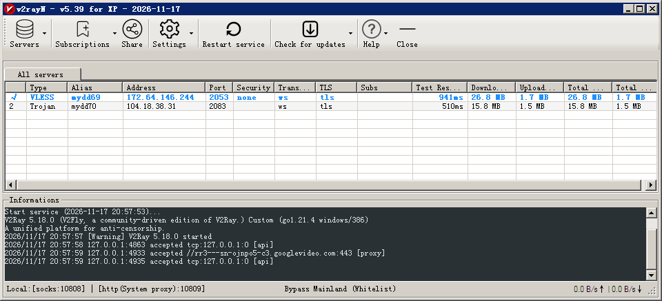
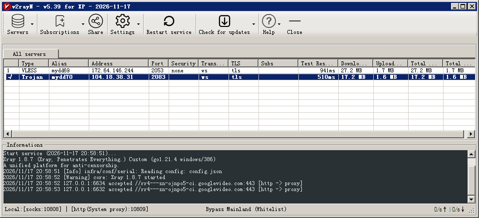

# v2rayN 5.39 for Windows XP
 
 
A Windows XP-compatible adaptation of [2dust/v2rayN](https://github.com/2dust/v2rayN), based on upstream version 5.39.

### How to use
- Download v2rayN_5.39_for_XP.zip from release and extract it
- Download v2ray-core or xray-core and route rules, put v2ray.exe or xray.exe、geoip.dat、geosite.dat in the same folder with v2rayN.exe
- Run v2rayN.exe

### Requirements  
- Microsoft .NET Framework 4.0 for XP
- v2ray-core、xray-core for XP [https://github.com/ihidao/v2ray-core_xray-core_for_XP](https://github.com/ihidao/v2ray-core_xray-core_for_XP)
- route rules [https://github.com/Loyalsoldier/v2ray-rules-dat](https://github.com/Loyalsoldier/v2ray-rules-dat)

### XP compatibility notes
- The application is built for .NET Framework 4.0 and x86.
- gRPC traffic statistics are disabled in this XP build.
- The upstream V2Ray/Xray core releases are not guaranteed to run on Windows XP. Use core binaries specifically built for XP.
- Windows XP's built-in Schannel does not provide the TLS 1.2 support available on newer Windows versions. HTTPS access to services that require TLS 1.2 may fail unless a separate TLS-capable proxy/provider is used.

